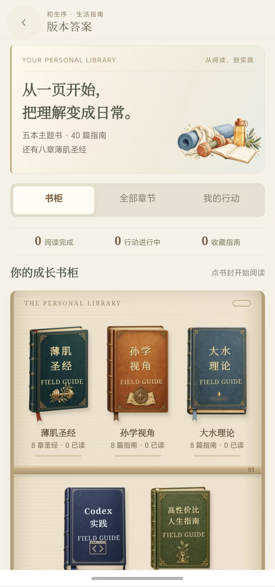

# 书柜内容与界面检查记录

2026-10-13。仅更新开发预览，未提交、推送、打包或发布。保留现有认证修改。

## 内容与功能

五个主题各八篇，合计 40 篇指南，另有八章薄肌圣经。新增 24 篇实践指南，覆盖居家和器械训练、饮食记录、恢复和复盘；信息核对与个人实验；饮水场景与饮料标签；Codex 入口、上下文、修复、界面验收与技能说明；环境、起步、复习与备份。每篇有具体正文、三步执行清单与出处。属于选编和原创整理，不宣称收录完整原书或访谈逐字稿。

新增按章节排序、预计阅读时间、手动读完、各书进度、前后章及目录；字号偏好持久保存。行动支持日期、步骤、复盘、完成状态和摘要复制。旧收藏、行动兼容，数据仍按账号隔离。阅读状态不影响健康评分。返回已有书柜时复用页面，避免反复打开目录压满微信页面栈。

## 实际修复

- 记录页把嵌套 Ref 直接用于条件，导致已加载仍显示加载中；改为顶层响应式绑定，实际 SFC 模板 SSR 回归验证。
- 没有体重记录时把 0 当作真实体重计算成果；里程碑增加真实记录和目标方向判断，未知进度、BMI 与目标显示待记录或待设置。
- 健康记录服务吞掉本机存储异常；现在返回保存失败，不假称保存成功。实际服务与 store 的配额失败回归通过。
- 首页昵称和时间分行，空目标卡片提供直接记录入口，版本答案前移；320px 文案调整，避免孤字和插图重叠。
- 我的页标题和说明分层，替换无法使用的提醒入口为真实行动日程，数据说明与本机能力一致。
- 睡眠、运动、心情采用共享导航，移除重复顶部留白。插图完整显示，正文在插图下方；运动分类改三列、足够点击高度。
- 健康详情增加对应阅读入口，计划和我的页接入书柜与行动；阅读仍与日常健康记录分别保存。
- 独立审查发现跨行动保存会清掉未保存草稿、首次深链未定位行动；均修正，并增加回归。书柜标签切换也保留草稿。

## 素材

新生成透明背景水彩行动手账静物，原图位于 assets/illustrations/version-answer/workspace-scene.png。界面使用约 23.6KB 的衍生图，出现在行动、计划与我的页；保留已有模型书封、纸张与装饰。

## 资料核对

本轮核对 OpenAI Codex 官方 quickstart/prompting/skills、openai/codex README 与运行安全说明，CDC 饮水资料、ACSM 2026 抗阻训练更新，以及 HowToLiveBetter 精力、时间、账号安全和技能章节。链接在 features/version-answer/sources.ts 和各篇出处中保留。人物原视频的可访问范围见 2026-10-13-version-visual-research.md；没有取得全文字幕，因此没有把二手笔记写成本人原话。

## 验证

- 完整测试：89 个文件通过，272 项通过，1 项原有跳过。后续体重未知文案、记录布局和我的页格式调整的相关 11 项测试再次通过。
- vue-tsc、相关 TypeScript/脚本 ESLint 与仓库结构检查通过。
- 微信开发 watcher 完成，产物完整性检查通过，约 2.39 MB；仅为 dist/dev/mp-weixin。
- 浏览器使用实际 Vue 页面与共享样式、独立合成测试数据；检查首页、记录、计划、我的、体重、饮水、睡眠、运动、心情、薄肌和阅读相关页面。320/375px 检查主要布局，首页与运动页面无横向溢出。
- 实际操作验证读完与字号保持、前后篇、添加行动、日期/步骤/笔记保存及刷新、跨行动和标签切换草稿保持、摘要复制。
- 真机及微信胶囊表现需要在微信开发者工具和设备预览最终确认。没有新 App 安装包。

