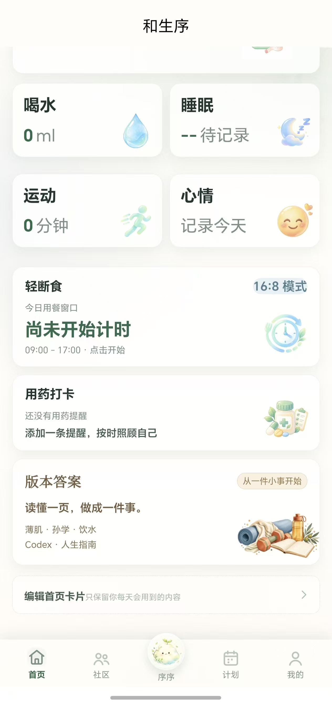
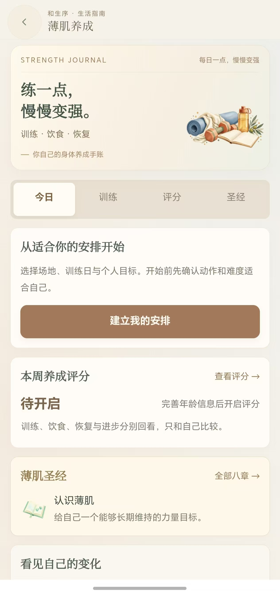

# 版本答案开发预览

更新时间：2026-10-13。等待用户体验后再决定打包；当前没有新 APK 或发布产物。

## 查看界面

本机浏览器： http://127.0.0.1:4318/?page=version 。此预览使用实际 Vue 页面及独立测试数据，训练记录不会同步真实账号。薄肌界面： http://127.0.0.1:4318/?page=hub 。

## 微信开发者工具

导入项目根目录：D:\禾伴\heban-ai-health-demo\apps\mini 。项目配置 miniprogramRoot 已指向 dist/dev/mp-weixin/。编译目录完整性检查通过，开发预览约 2.42 MB。该目录是编译结果，不需要导入 apps/mini/src。

如重启开发编译，在 PowerShell 执行：

```powershell
powershell -ExecutionPolicy Bypass -File "D:\禾伴\heban-ai-health-demo\scripts\preview-mini.ps1"
```

保持窗口运行，再在微信开发者工具点击编译。脚本只编译开发预览；完成编译后去掉已有远程引用图片的生成副本，保留源图。没有上传或云打包操作。

## 建议验收顺序

1. 男性资料保存后首页经期默认隐藏，版本答案入口可打开。已有手动卡片偏好保留，可在卡片设置调整。
2. 点击五本书，分别检查薄肌圣经和主题指南。
3. 阅读页收藏、放大字号、标记读完、前后章节、复制模板、加入行动，再到我的行动安排日期、勾选步骤、写笔记并保存；刷新检查结果仍在。
4. 薄肌模块设置计划、保存训练、填写证据并检查评分范围与缺失记录提示。
5. 切换账号，检查收藏、行动和训练记录互不混用。

书柜内共有 40 篇指南，每个主题八篇，另有八章薄肌圣经。内容包括起步、操作、检查和复盘。人物原视频、饮水官方资料、Codex 官方文档与 HowToLiveBetter 仓库链接保留在正文出处；人生指南保留 CC BY 4.0 署名。正文为选编与原创实践整理，不能当成原书全文或邵艾伦完整视频逐字稿。

阅读完成与行动完成分别保存，阅读不会增加健康评分。我的行动支持进行中/已完成筛选、日期、三步清单和 500 字复盘；在书柜内切换标签或保存另一项行动会保留正在编辑的草稿。离开页面前仍需点击保存。计划页和我的页提供书柜行动入口。

## 10 月 13 日视觉更新

统一贴近画布的导航与动效，补充书封和阅读静物；正文目录定位、字号与章节位置已验证，训练输入与 44px 删除按钮在 320/375px 无溢出，饮水杯比例恢复。详情见 2026-10-13-version-visual-research.md。微信开发预览目录检查通过。

下午检查进一步修复记录页一直加载、体重无数据误报里程碑、本机保存失败没有反馈等问题；调整首页、我的、睡眠、运动、心情与阅读页的文字层级、插图和窄屏布局。新增模型生成的行动手账静物，用于书柜、计划与我的页。详细验证见 [检查记录](./2026-10-13-library-depth-audit.md)。

## 圆弧与微信样式修复

首页沿用原来的健康记录顺序，恢复体重圆弧，无目标也展示真实当前值或待记录，新增的大按钮已撤掉。四餐图标和文字保留完整；版本答案移至下方、编辑首页之前。

薄肌共享基础样式由 App.vue 统一加载。原页面 style src 在微信产物遗漏的问题已复现并修复，verify-mini-build 现在会检测真实 app.wxss 的核心布局声明。今日、训练、评分、圣经分别呈现，书柜四个实践入口直接到对应功能。今日评分固定当前周，历史周不再污染；复盘定位等待年龄信息与页面节点挂载，并使用页面级锚点。

完整测试 280 项通过、1 项原有跳过；类型与开发产物检查通过。微信开发者工具点击编译即可查看当前开发目录，无需清除个人记录。浏览器验收采用独立测试数据，真机尚待验证。



